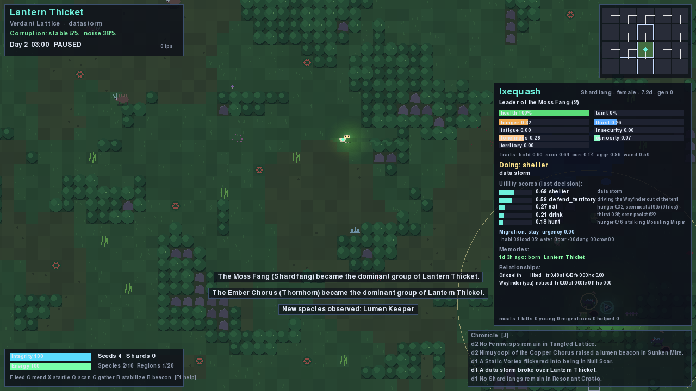
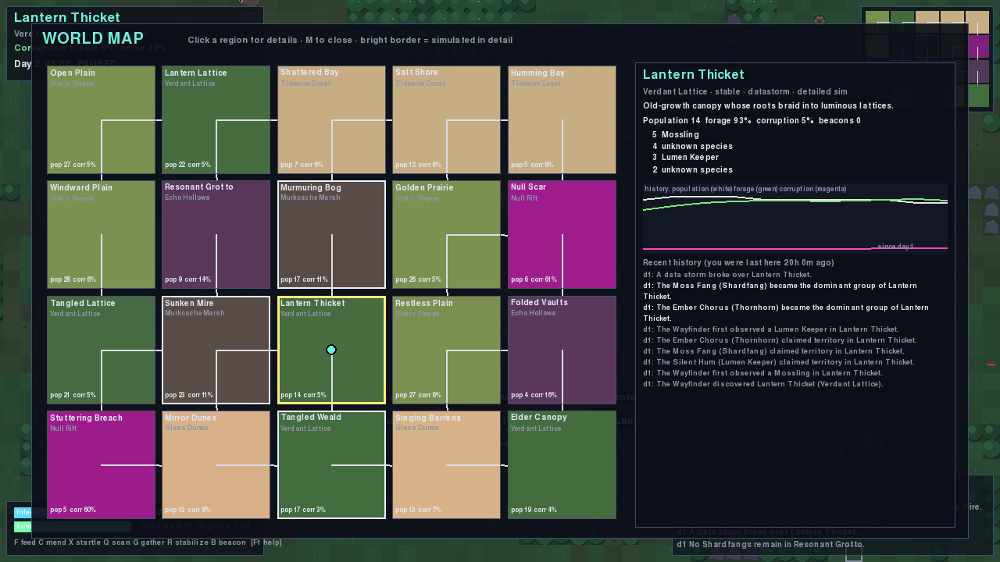
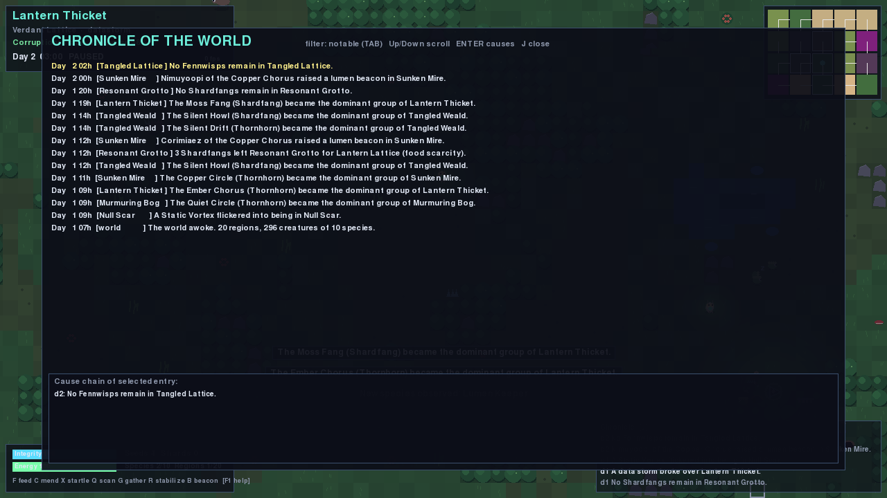
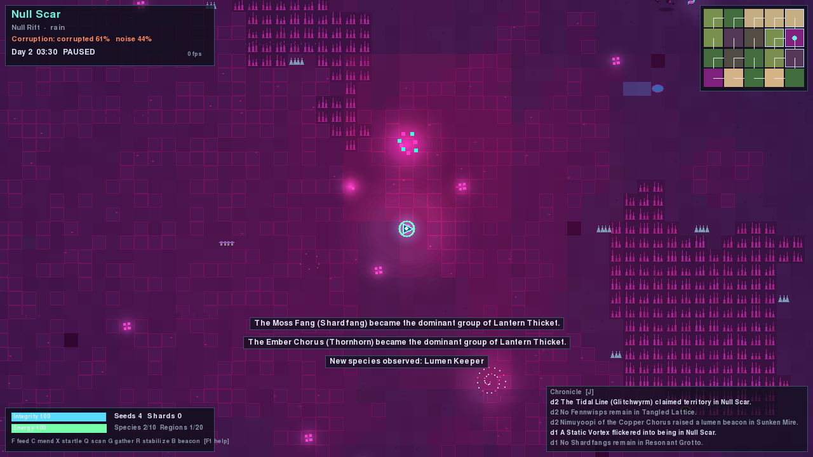
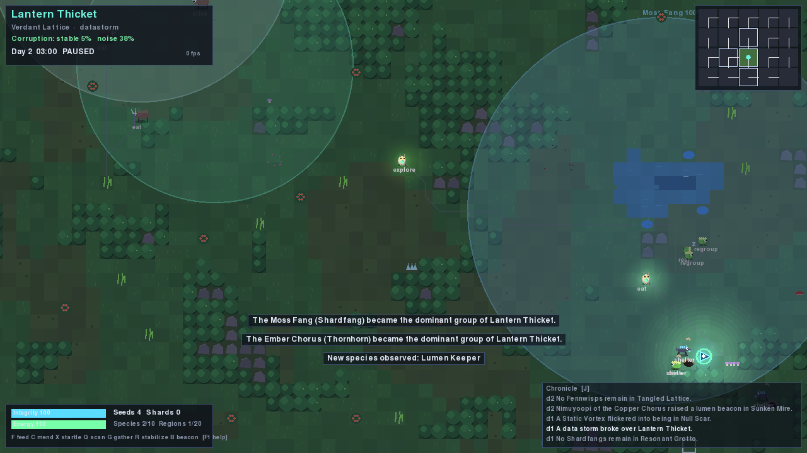

# Digital World

Mundo digital fantástico, persistente y autónomo, escrito íntegramente en Python.
Criaturas originales con necesidades, personalidad, memoria y relaciones viven,
compiten, migran y mueren en un mundo de regiones conectadas que se corrompe y se
recupera — exista o no el jugador. El jugador (el *Wayfinder*) explora, observa e
interviene, y el mundo recuerda lo que hace.

> Principio de diseño: **no simular procesos innecesariamente; simular consecuencias.**



| | |
|---|---|
|  |  |
|  |  |

## Instalación y ejecución

Requisitos: Python 3.10+ (probado con 3.13), `pygame-ce` y `numpy`.

```bash
python -m pip install -r requirements.txt
python -m digitalworld                    # pantalla de título (Continuar / Nuevo mundo)
python -m digitalworld --new --seed 42    # empezar un mundo nuevo directamente
```

Windows: `run_windows.bat` (instala dependencias y arranca). Linux/macOS: `./run.sh`.

### Simulación sin ventana (headless)

```bash
python -m digitalworld --headless --ticks 4320 --save   # 3 días de mundo, guarda al final
python -m digitalworld --headless --load --ticks 1440   # continúa la partida guardada
```

### Diagnóstico

```bash
python -m digitalworld.tools.inspect summary              # estado de todas las regiones
python -m digitalworld.tools.inspect region "Lantern Thicket"   # evolución y qué pasó en tu ausencia
python -m digitalworld.tools.inspect why <id|nombre>      # puntuaciones Utility AI, migración, comida
python -m digitalworld.tools.inspect creature <id|nombre> # memoria y relaciones
python -m digitalworld.tools.inspect history --min 2      # crónica (con ids de causas)
python -m digitalworld.tools.inspect causes <id>          # cadena causal de un acontecimiento
python -m digitalworld.tools.inspect validate             # integridad e identidades de la partida
python -m digitalworld.tools.inspect profile --ticks 2000 [--big]   # coste por sistema
python -m digitalworld.tools.screenshots --out docs/screenshots     # capturas automáticas
```

### Pruebas

```bash
python -m pip install -r requirements-dev.txt
python -m pytest -q
```

### Ejecutable

`build_windows.bat` (o `pyinstaller packaging/digitalworld.spec --noconfirm`) genera
`dist/DigitalWorld/`. El empaquetado es opcional: el juego siempre se puede ejecutar desde el código.

## Controles

| Acción | Tecla |
|---|---|
| Moverse / correr | WASD o flechas / Shift |
| Alimentar a la criatura cercana (semillas) | F |
| Curar / estabilizar una criatura (20 energía) | C |
| Espantar | X |
| Escanear | Q |
| Recolectar de una planta o depósito de esquirlas | G |
| Pulso de estabilización de corrupción (30 energía) | R |
| Levantar una baliza (5 esquirlas) / desmontar una baliza | B / V |
| Descansar 6 h (el mundo entero avanza) | N |
| Pausa / más lento / más rápido | Espacio / `[` / `]` |
| Mapa del mundo / crónica / diario y bestiario / ayuda | M / J / K / F1 |
| Inspeccionar criatura | clic izquierdo (clic derecho deselecciona) |
| Territorios / overlay de depuración / perfilador / zoom | L / Tab / F3 / rueda o Z |
| Guardar / cargar / menú | F5 / F9 / Esc |

## Qué contiene el mundo

* **7 biomas** con terreno procedural propio: Verdant Lattice (bosque), Tidewire Coast (costa),
  Murkcache Marsh (pantano), Echo Hollows (cuevas), Glass Dunes (desierto), Static Steppe (estepa)
  y Null Rift (región digital anómala). Por defecto 5×4 regiones de 64×48 casillas conectadas por
  pasos en sus bordes (el grafo siempre es conexo).
* **10 especies originales** definidas por datos (`digitalworld/content/data/species.json`):
  Mossling, Glimmerhare, Thornhorn, Shardfang, Fennwisp, Coralynx, Bitmite, Glitchwyrm,
  Lumen Keeper y Dunestrider. Herbívoros, depredadores, omnívoros y carroñeros; manadas, rebaños y
  solitarios; territoriales o no; diurnos o nocturnos; capacidades como nadar, acosar en grupo
  (*mob*), reproducción asexual, emitir corrupción, romper estructuras o construir balizas.
* **10 tipos de recurso** con cantidad, capacidad, regeneración dependiente de fertilidad, estación,
  lluvia y corrupción, degradación por sobreexplotación y recuperación.

## Arquitectura

```
digitalworld/
  core/         reloj lógico (1 tick = 1 minuto), runner de paso fijo, eventos e historia, RNG, perfilador
  content/      registro validado de especies, biomas y recursos (JSON)
  world/        terreno procedural, regiones, recursos, estructuras, anomalías, territorios, generador
  entities/     criaturas (estado individual), memoria, relaciones, grupos
  ai/           percepción, Utility AI (19 acciones), cerebro con histéresis, movimiento
  nav/          A* en rejilla con presupuesto por tick y coste por corrupción
  sim/          orquestador, necesidades, ecología, corrupción/clima, migración, social/territorios,
                simulación abstracta (LOD) y crónica
  player/       estado del Wayfinder e interacciones que modifican el mundo
  persistence/  SQLite versionado, escritura atómica, validación, migración de formatos
  render/       front-end pygame-ce (vista, arte procedural, HUD, overlays, app)
  audio/        sonido procedural con NumPy (opcional)
  tools/        CLI de diagnóstico y capturas
```

* La **simulación es la fuente de verdad** y no importa nada de `render`. Funciona sin ventana.
* **Tiempo lógico independiente de los FPS**: `FixedStepRunner` convierte tiempo real en ticks
  (pausa, ×0.5–×16), limita el trabajo por frame y descarta el atraso si se supera el presupuesto.
* **Orden de un tick**: reloj → índice espacial → entorno (clima, regeneración, corrupción, fuga
  entre regiones) → criaturas (necesidades, decisión, acción, movimiento) → migración → grupos y
  territorios → altas/bajas/traslados diferidos → una región latente → crónica → equilibrio.
  Un fallo en una criatura se registra y se aísla; no detiene el mundo.

### Niveles de detalle y ausencia

* La región del jugador y sus vecinas se simulan **en detalle** (cada criatura con IA).
* El resto está **latente**: sus criaturas se guardan como datos serializados y la región avanza en
  pasos de una hora con las mismas tasas y el mismo modelo de idoneidad (comen individuos concretos,
  pasan hambre, son cazados, nacen, envejecen, migran, actualizan memoria). Las identidades se
  conservan en todas las transiciones (hay pruebas de que no se duplican).
* Al recargar una partida se simula el tiempo real transcurrido (configurable y acotado) y el juego
  informa de lo ocurrido. `N` (descansar) hace lo mismo dentro del juego.

### IA

Utility AI: cada decisión puntúa todas las opciones aplicables (comer, beber, cazar, descansar, huir,
refugiarse, evitar corrupción, explorar, investigar anomalías, defenderse, ayudar a aliados, defender
territorio, socializar, reagruparse, acercarse al jugador, aparearse, migrar, construir, deambular)
según necesidades, percepción, rasgos, memoria, relaciones y riesgo. Incluye compromiso con la acción
en curso, inercia del sueño, prohibición temporal de objetivos imposibles, frustración de búsqueda y
ruido de decisión proporcional a la corrupción acumulada. Cada criatura guarda las últimas decisiones
con sus puntuaciones y motivos (visibles en el inspector y en `inspect why`). No se usa ningún
modelo de lenguaje: todo es local y reproducible por semilla.

### Corrupción

Campo por región (celdas de 4×4 casillas) con nivel, estabilidad, ruido de señal, intensidad de
anomalías, resistencia y tendencia a propagarse. Efectos sistémicos: frena la vegetación y alimenta
el *bytebloom*, contamina el agua, acumula *taint* en criaturas poco tolerantes (daño, decisiones
erráticas), encarece rutas, reduce la percepción, empuja migraciones y erosiona estructuras.
Fuentes: anomalías, Glitchwyrms, tormentas de datos y fuga por los pasos. Sumideros: vegetación sana,
balizas de los Lumen Keepers o del jugador y el pulso de estabilización. Los efectos visuales
(tinte, bloques desplazados, líneas) son aparte y solo cosméticos.

### Persistencia

SQLite (`saves/<nombre>.db`), formato versionado (v2, con migración desde v1). Se escribe a un
temporal, se verifica (integrity check y recuento) y solo entonces se sustituye; la partida anterior
queda como `.bak` y se usa automáticamente si la principal está dañada. Se rechaza guardar si hay
identidades duplicadas. Las filas dañadas se omiten al cargar y los campos que faltan toman valores
por defecto. No se serializa ningún objeto gráfico.

Las partidas y registros se guardan en `%APPDATA%\DigitalWorld` (Windows) o `~/.digitalworld`
(otros), o donde indique `--data-dir` / `DIGITALWORLD_HOME`. Configuración opcional:
`config.json` en ese directorio (ver `config.example.json`).

### Recursos artísticos

Todo el arte y el sonido se generan proceduralmente en tiempo de ejecución (originales). Se pueden
sustituir colocando `assets/sprites/<especie>.png` o `assets/sounds/<nombre>.wav`.

## Estado y limitaciones conocidas

Ver [DEVLOG.md](DEVLOG.md) para decisiones, resultados de pruebas y mediciones. Resumen honesto:

* Probado en Linux (Python 3.13, pygame-ce 2.5.8) con controlador de vídeo *dummy*: el render se
  verificó mediante capturas automáticas, no jugando en una pantalla física. **No se ha probado en
  Windows**; el código evita dependencias específicas de plataforma y usa `%APPDATA%`.
* El audio procedural se inicializa y reproduce con el controlador *dummy*; no se ha podido escuchar.
* El ejecutable de PyInstaller se construyó y ejecutó en Linux; la compilación para Windows debe
  hacerse en Windows (`build_windows.bat`).
* El equilibrio ecológico se ajustó con ejecuciones de 30 días: las poblaciones oscilan y coexisten,
  pero los depredadores pueden bajar mucho en algunas semillas (la inmigración desde el
  "Outer Static", registrada en la crónica, evita extinciones globales).
* El jugador no tiene combate ni inventario complejo por diseño (prioridad: exploración e interacción).
